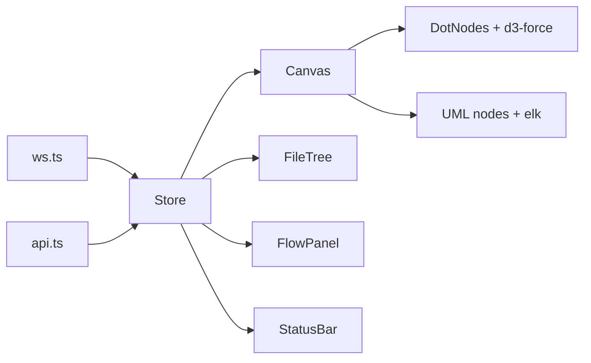

# XTree Front End: Implementation Plan (Handoff)

Source spec: `specs.md`. Visual reference: `841120454_1842953097138308_4935374331865918092_n.png` (Obsidian graph view).

## Problem Statement
Build the XTree browser UI (`web/`) from specs.md. It uses an Obsidian-style graph look with two canvas modes, and talks to the Node server through REST and WebSocket. This plan covers the front end only. The server and analyzer are assumed to exist or be built separately.

## Requirements (decisions made)
- **Two canvas modes.** "Graph" is an overview of dots with a force layout. "UML" shows cards laid out by elk, per spec F3.
- **Look:** similar to the screenshot: dark theme, left icon rail, tab bar, floating Filters/Display/Forces panel. Spec layout kept: file tree on the left, canvas in the middle, right panel for walkthrough.
- **Scope:** F1 to F5 (P0), plus F9 (status bar) and F6 (flow walkthrough). Chat (F7) and settings UI (F8) are out of this pass.
- **Constraints:** servers bind to 127.0.0.1, UI is read-only, UI draws only parser edges (never LLM-invented ones).

## Background
- Stack: React 18, Vite, `@xyflow/react`, `elkjs`, `shiki`, `ws` client, Zustand, `d3-force`.
- API and WS message types: specs.md sections 7 and 8. Copy them into `web/src/types.ts`.
- React Flow has no force layout. Graph mode computes positions with `d3-force` and renders them as React Flow custom circle nodes, so both modes share one pan/zoom engine and selection state.
- Layout: left icon rail, tab bar, file-tree sidebar, canvas, right panel, top status bar. The floating graph-settings panel sits over the canvas.

## Proposed Solution
- A single Zustand store holds `graph`, `selection`, `mode`, `summaries`, `status`, `flow`. WS messages update it.
- Custom React Flow node types: `DotNode` (Graph mode); `FunctionNode`, `ClassNode`, `TypeNode`, `ExternalNode` (UML mode).
- A toolbar mode toggle. Double-clicking a dot, or zooming past a threshold, switches to UML mode centered on that node.
- Existing node positions stay stable across graph diffs.

## Task Breakdown

### Task 1: Scaffold the app shell and theme
- Create the Vite and React workspace in `web/`, with dark Obsidian-like theme tokens.
- Build the layout: icon rail, tab bar with a "Graph view" tab, sidebar slot, canvas slot, right-panel slot.
- Test: smoke render test (Vitest + Testing Library).
- Demo: the empty themed shell loads at localhost:5173.

### Task 2: Types, API client, store, mock fixture
- Add shared types, `api.ts` (`/api/files`, `/api/graph`, `/api/status`) and the Zustand store.
- Add a mock fixture of the shop-app graph so the front end runs without the server.
- Test: store reducer tests; API client tests with fetch mocks.
- Demo: the app loads fixture data into the store.

### Task 3: File tree and entry selection (F1)
- Render the tree from `/api/files` with folder expand/collapse.
- Clicking a file sets the entry and calls `/api/graph`.
- Test: a click triggers the graph load.
- Demo: pick `AddToCart.ts` and the graph data appears in the store (raw list for now).

### Task 4: Graph mode canvas (dots)
- `DotNode` circles with labels below, faint arrow edges, `d3-force` layout.
- Pan, zoom, drag, minimap, click-to-select.
- Test: layout unit test (no overlapping nodes, deterministic seed).
- Demo: Obsidian-style overview of the shop-app graph.

### Task 5: Floating graph-settings panel
- Filters (search box, show externals, show types); Display (arrows, node size, link thickness, text fade threshold); Forces (center, repel, link distance, Animate button).
- Sliders update the store live. The panel is collapsible.
- Test: controls update store state.
- Demo: sliders visibly change the graph.

### Task 6: UML mode (F3)
- `FunctionNode`, `ClassNode`, `TypeNode`, `ExternalNode` with `+ - #` visibility markers, «interface» headers, collapsible shiki-highlighted source, and an LLM summary line.
- Elk layered left-to-right layout. Edge styles: solid with call-order numbers for `calls`; dashed for `uses-type`; hollow triangle for `extends`; dashed with hollow triangle for `implements`.
- Wire up the mode toggle and the double-click/zoom transition.
- Test: node snapshot tests; elk layout test on fixture data.
- Demo: switch to UML mode and see classes, interfaces and numbered call arrows.

### Task 7: Search and navigation
- Symbol search box with jump-to. Pan and highlight work in both modes.
- Test: search matching and the focus action.
- Demo: type `reserve` and the canvas centers on `Inventory.reserve`.

### Task 8: WebSocket and streamed summaries (F4)
- `ws.ts` with auto-reconnect handles `summary.token`, `summary.done`, `status`.
- Cards show streaming text and a failed state with a retry button.
- Test: simulated WS stream updates a card.
- Demo: summaries type themselves onto the cards.

### Task 9: Live updates (F5)
- Handle `graph.diff`. Changed cards get a "changed" badge that fades after 10 seconds. Added/removed nodes animate. Existing positions stay stable after relayout.
- Test: diff reducer tests; positions-preserved test.
- Demo: edit a function and only its card updates.

### Task 10: Status bar (F9)
- Show model name, Ollama state, queue progress ("summaries 12/30") and a "Running 100% locally" badge. When Ollama is down, show the `ollama pull` setup hint.
- Test: status rendering across states.
- Demo: stop the mock Ollama and the bar and cards degrade gracefully.

### Task 11: Explain-flow walkthrough (F6)
- An "Explain flow" button on a selected function calls `/api/explain-flow`. The right panel lists the steps. Stepping highlights the matching node and edge and pans to it. Steps with unknown `symbolId`s are dropped.
- Test: step navigation and invalid-step filtering.
- Demo: click through the flow along the call path.

### Task 12: Hardening and integration
- Collapse method bodies when the graph exceeds 150 nodes, with a warning. Show a parse-error badge. Verify against the real server.
- Test: end-to-end smoke test against `examples/shop-app` covering the front-end parts of acceptance criteria 2 to 6.
- Demo: full flow on shop-app, including with Wi-Fi off.

## Open Items for the Executor
- Confirm the server's `/api/files` response shape matches the one assumed in Task 2.
- Decide whether to keep a Graph-only fallback if the UML transition runs late.
